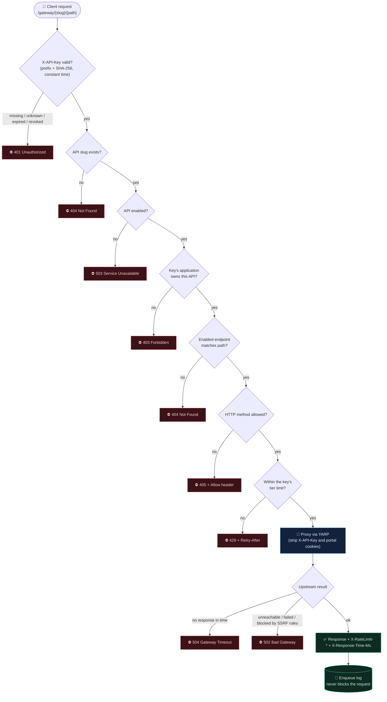
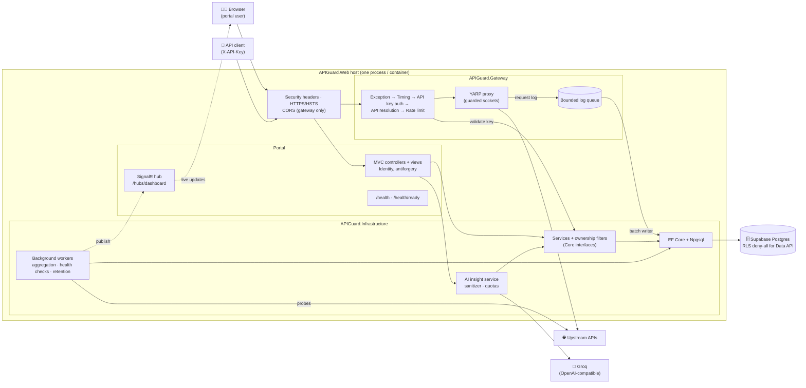
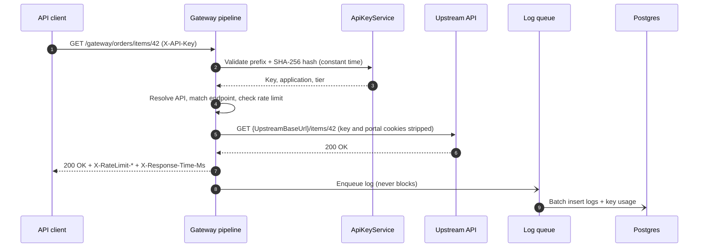
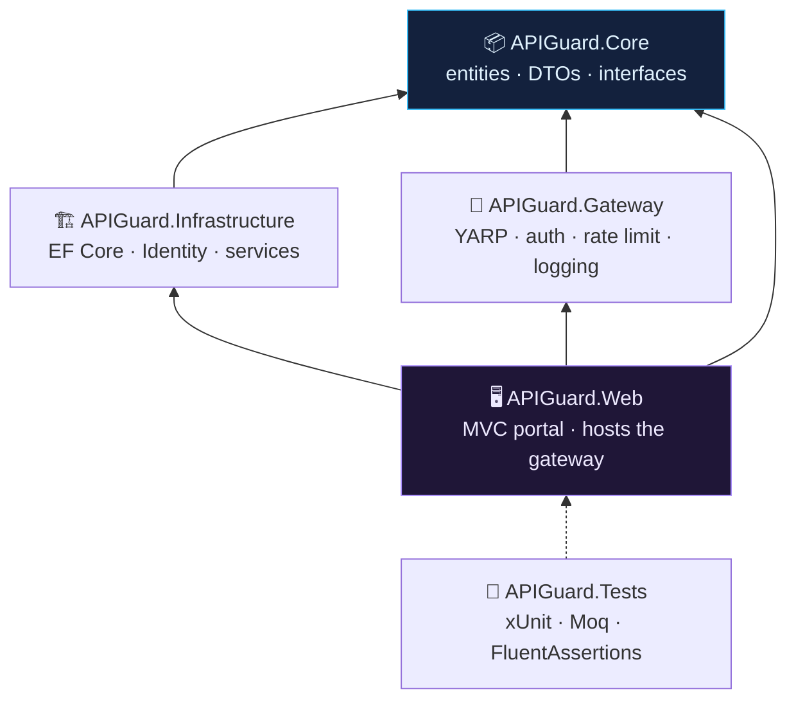
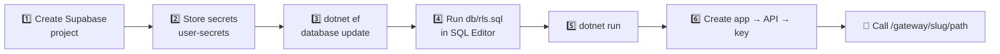
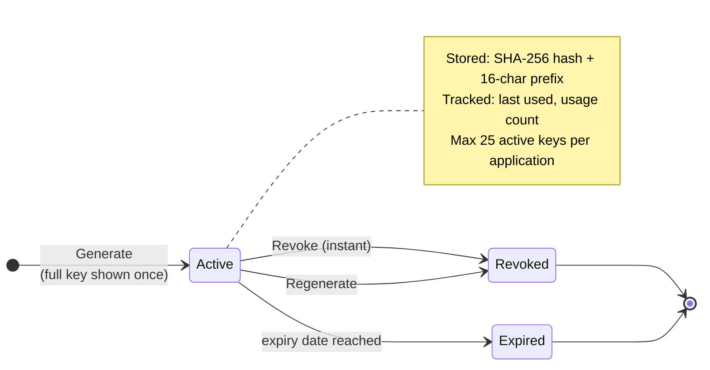
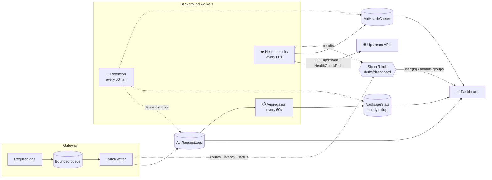
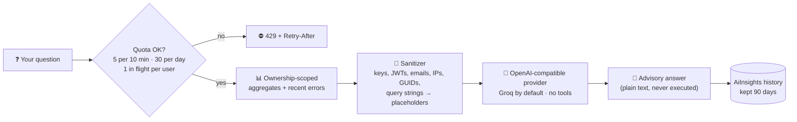
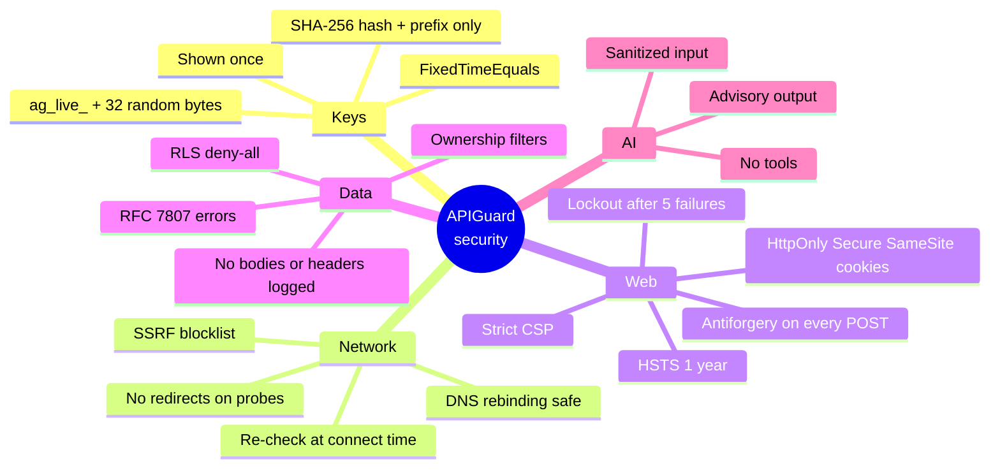
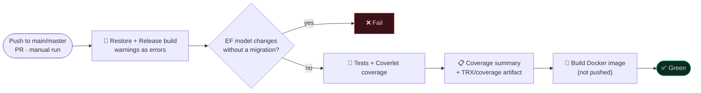

<div align="center">


<br/>

[](https://github.com/saran-77/api-guard/actions/workflows/ci.yml)


**A simplified API gateway with key management, rate limiting, request analytics and a live dashboard.**

[Features](#-features) · [How it works](#-how-it-works) · [Quick start](#-quick-start) · [Gateway](#-gateway) · [Dashboard](#-analytics-dashboard) · [AI assistant](#-ai-assistant) · [Security](#-security) · [Config](#-configuration-reference)

</div>

---

## ✨ Features

| | Feature | What you get |
|---|---|---|
| 🚪 | **Gateway** | YARP reverse proxy at `/gateway/{slug}/...` with database-driven routes, endpoint allow-lists, per-key rate limiting, SSRF-safe upstream connections and async request logging |
| 🔑 | **API keys** | `ag_live_...` keys shown once, stored as SHA-256 hashes, with expiry, revoke, regenerate, last-used and usage counts |
| 🧭 | **Portal** | Applications, APIs, endpoints, keys and rate-limit tiers with Developer/Admin roles and per-user ownership |
| 📊 | **Analytics** | Traffic, error rates, latency, slowest endpoints and upstream health, with live SignalR updates |
| 🤖 | **AI assistant** | Ask questions about your own sanitized telemetry; answers are advisory hypotheses only |
| 🛡️ | **Operations** | Security headers, strict CSP, health endpoints, Docker image, GitHub Actions CI, Supabase RLS script, Azure App Service guide |

---

## 🧩 How it works

### The request journey (animated)

<div align="center">
  
</div>

### Decision flow: what happens to every request



### System architecture



### Request sequence



### Project layering



> **Rule of thumb:** `Core` holds entities, DTOs and interfaces only. `Infrastructure` implements them with EF Core. `Gateway` depends on `Core` interfaces only, so it never touches the database directly. `Web` composes everything.

---

## 🚀 Quick start



```bash
git clone https://github.com/saran-77/api-guard.git && cd api-guard
dotnet tool restore

# 1. Create a Supabase project and copy the session pooler connection string
dotnet user-secrets set "ConnectionStrings:Default" "<connection string>" --project APIGuard.Web
dotnet user-secrets set "AdminSeed:Email"    "you@example.com"  --project APIGuard.Web
dotnet user-secrets set "AdminSeed:Password" "<Strong#Pass123>" --project APIGuard.Web

# 2. Create the schema, then run db/rls.sql in the Supabase SQL Editor
dotnet ef database update --project APIGuard.Infrastructure --startup-project APIGuard.Infrastructure

# 3. Run
dotnet run --project APIGuard.Web --launch-profile https   # https://localhost:7049
```

Sign in with the admin account, create an application, add an API with its upstream URL and endpoints, generate a key, then call:

```bash
curl -i "https://localhost:7049/gateway/<slug>/<path>" -H "X-API-Key: ag_live_..."
```

**Prerequisites:** .NET 8 SDK (or newer SDK with the .NET 8 / ASP.NET Core 8 runtimes), a Supabase account, and `dotnet tool restore` for the pinned `dotnet-ef` 8 tool.

<details>
<summary><b>🗄️ Supabase setup (step by step)</b></summary>

### 1. Create the project
1. Sign in at [supabase.com/dashboard](https://supabase.com/dashboard) and click **New project**.
2. Pick an organization, a name (e.g. `apiguard`) and a nearby region.
3. Set a strong **database password** and store it safely.
4. Wait about 1-2 minutes for provisioning.

### 2. Find the connection string
Click **Connect**, then choose the **Session pooler** (port `5432`). It works on IPv4 and supports EF migrations.

| Connection | Use it for |
|---|---|
| **Session pooler** (5432) | Migrations and runtime. Best default |
| **Transaction pooler** (6543) | Runtime only. APIGuard adds `No Reset On Close=true` and disables auto-prepare automatically |
| **Direct** (`db.<ref>.supabase.co`) | IPv6-only unless you enable the IPv4 add-on |

```text
Host=aws-0-<region>.pooler.supabase.com;Port=5432;Database=postgres;Username=postgres.<project-ref>;Password=<db-password>;SSL Mode=Require
```

### 3. Store secrets

```bash
dotnet user-secrets set "ConnectionStrings:Default"    "<session or transaction pooler string>" --project APIGuard.Web
dotnet user-secrets set "ConnectionStrings:Migrations" "<session pooler or direct string, port 5432>" --project APIGuard.Web
dotnet user-secrets set "AdminSeed:Email"    "you@example.com"  --project APIGuard.Web
dotnet user-secrets set "AdminSeed:Password" "<Strong#Pass123>" --project APIGuard.Web
dotnet user-secrets set "Groq:ApiKey"        "<groq-api-key>"   --project APIGuard.Web   # optional
```

Environment variables also work (`ConnectionStrings__Default`, `AdminSeed__Email`, ...). `appsettings.Example.json` lists every key. Never commit real values.

### 4. Apply the migration

```bash
dotnet ef database update --project APIGuard.Infrastructure --startup-project APIGuard.Infrastructure
```

### 5. Enable Row Level Security
Paste `db/rls.sql` into the Supabase **SQL Editor** and run it. It is idempotent, so re-run it after migrations that add tables. It enables RLS, adds a deny-all policy for `anon` / `authenticated` and revokes their privileges. The backend connects as the table owner (bypasses RLS) and enforces ownership itself.

### Troubleshooting

| Symptom | Likely cause |
|---|---|
| Timeout / "No such host" | You're on the IPv6-only direct host from an IPv4 network. Use the session pooler |
| SSL errors | Keep `SSL Mode=Require` |
| "Tenant or user not found" | Pooler usernames are `postgres.<project-ref>`, not `postgres` |

On startup the app creates the `Developer` and `Admin` roles and the admin user from `AdminSeed:*`. With no database configured it still starts: `/health` returns 200 and `/health/ready` returns 503. New registrations get the `Developer` role.

</details>

<details>
<summary><b>🐳 Docker</b></summary>

The multi-stage `Dockerfile` publishes `APIGuard.Web` on `mcr.microsoft.com/dotnet/aspnet:8.0` as a non-root user, listening on plain HTTP `8080` (put TLS in front). Secrets are passed at run time and never baked into the image.

```bash
docker build -t apiguard .
docker run --rm -p 8080:8080 \
  -e ConnectionStrings__Default="<connection string>" \
  -e AdminSeed__Email="you@example.com" -e AdminSeed__Password="<Strong#Pass123>" \
  -e DataProtection__KeysPath=/keys -v apiguard-keys:/keys \
  apiguard
curl http://localhost:8080/health/ready
```

Auth and antiforgery cookies are `Secure`-only, so use the portal over HTTPS:

- **Behind a TLS-terminating proxy** (App Service, ingress, nginx): set `ASPNETCORE_FORWARDEDHEADERS_ENABLED=true`. Only do this when the proxy is the only way to reach the container.
- **Locally over HTTPS**: mount a dev certificate.

```bash
dotnet dev-certs https -ep ~/.aspnet/https/apiguard.pfx -p <cert-password>
docker run --rm -p 8443:8443 \
  -e ASPNETCORE_HTTPS_PORTS=8443 \
  -e ASPNETCORE_Kestrel__Certificates__Default__Path=/https/apiguard.pfx \
  -e ASPNETCORE_Kestrel__Certificates__Default__Password=<cert-password> \
  -v ~/.aspnet/https:/https:ro \
  -e ConnectionStrings__Default="<connection string>" \
  -e AdminSeed__Email="you@example.com" -e AdminSeed__Password="<Strong#Pass123>" \
  apiguard
```

Mount a volume for `DataProtection__KeysPath` so logins survive restarts.

</details>

---

## 🚪 Gateway

Every API is reachable at `/gateway/{apiSlug}/{**path}`. Routes and clusters come from the database and reload immediately when an API or endpoint changes, plus every `Gateway:RefreshIntervalSeconds` as a fallback.

```bash
curl -i "https://localhost:7049/gateway/weather/forecast/london?units=metric" \
  -H "X-API-Key: ag_live_..."
# forwarded to {UpstreamBaseUrl}/forecast/london?units=metric
```

**Pipeline order:** exception handling → request timing → API key auth → API resolution → rate limiting → YARP proxy → async request logging.

| Status | When |
|:---:|---|
| **401** | `X-API-Key` missing, unknown, expired or revoked (with `WWW-Authenticate`) |
| **403** | The key belongs to a different application than the API |
| **404** | Unknown API slug, or no enabled endpoint matches (an API with no enabled endpoints denies everything) |
| **405** | Path matches but the method isn't allowed (with `Allow`) |
| **429** | The key's tier limit is exceeded (with `Retry-After`) |
| **502** | Upstream unreachable or failed, or its address is blocked by SSRF rules |
| **503** | The API is disabled |
| **504** | Upstream didn't respond within `Gateway:UpstreamTimeoutSeconds` |

- Endpoint paths support `{param}` segments (e.g. `/users/{id}`); method `Any` allows everything. Deprecated APIs still proxy but add `Deprecation: true`.
- Response headers: `X-RateLimit-Limit`, `X-RateLimit-Remaining`, `X-Response-Time-Ms`.
- `X-API-Key` and portal cookies are stripped before forwarding. With `UpstreamValidation:BlockPrivateNetworks` on, the upstream IP is re-checked at connect time, which also defends against DNS rebinding.
- **Rate limiting** uses fixed windows per key and is **in memory per instance**. With several instances each applies the limit separately; a distributed limiter (e.g. Redis) would be needed to share it.
- **Logging** records API, key, method, path (no query string), status, latency, timestamp, client IP and error message. Bodies and headers are never logged. Logs flow through a bounded `Channel<T>` to a batch writer; if the queue fills, logs are dropped and counted instead of slowing traffic.
- **Browser clients:** list exact origins in `Gateway:CorsAllowedOrigins` (e.g. `["https://app.example.com"]`). Credentials are never allowed.

### 🔑 Key lifecycle & rate-limit tiers



| Tier | Limit (per key) | Notes |
|---|---|---|
| 🟢 **Free** | 100 / min | Default for new applications |
| 🔵 **Developer** | 500 / min | Admin-assigned |
| 🟣 **Premium** | 2000 / min | Admin-assigned |

**Regenerate** revokes the key and issues a replacement with the same name and lifetime. Only admins can change an application's tier.

---

## 📊 Analytics dashboard

Open **Dashboard** (`/Dashboard`). Developers see only their own APIs; admins see everything. Filter by 24h / 7d / 30d / 90d or a custom UTC range (up to 366 days), optionally per API.



| Metric | Definition |
|---|---|
| Total requests | Every logged gateway request in the range |
| Failed requests | Status code ≥ 400 |
| Success rate | (Total − Failed) / Total |
| Average latency | Mean `LatencyMs` |
| Requests per minute | Last 60 minutes, per minute |

Charts (Chart.js) cover traffic over time, status-code distribution, requests per minute and most used APIs; tables show slowest endpoints plus per-API health and uptime.

<details>
<summary><b>⚙️ Background workers and live updates</b></summary>

All three live under `Monitoring` in `appsettings.json` and can be disabled.

| Worker | Default cadence | What it does |
|---|---|---|
| **Aggregation** | every 60s | Recomputes the last 1 hourly bucket into `ApiUsageStats` (backfills 48h on first start). Upserts are idempotent |
| **Health checks** | every 60s | `GET {UpstreamBaseUrl}{HealthCheckPath}` for each non-disabled API (5s timeout, max 8 parallel). Anything below 500 is healthy. No redirects; same SSRF guard as the gateway |
| **Retention** | every 60 min | Deletes request logs > 30 days, usage stats > 365 days, health checks > 7 days, in batches |

**Live updates:** the SignalR hub requires login (anonymous gets 401). Each connection joins one group: `user:{id}` for developers or `admins`. Messages carry only counts, latency and status, never keys, headers or query strings. The page updates tiles and the per-minute chart instantly, then refetches full data at most every 10 seconds.

Data sources: totals, traffic and most-used APIs come from the hourly rollup plus raw logs for the newest hours. Status codes, slowest endpoints and per-minute rates come from raw logs, so they only cover the retention window.

</details>

---

## 🤖 AI assistant

Open **Assistant** (`/Assistant`) and pick a quick question (*Summarize today's performance*, *Why are there 500s?*, *Which API is slowest?*) or type your own (3 to 500 characters), optionally scoped to one API.



**Setup**

```bash
dotnet user-secrets set "Groq:ApiKey" "<groq-api-key>" --project APIGuard.Web
```

Without a key the page explains the assistant isn't configured and makes no calls. To use OpenAI, set `Groq:BaseUrl` to `https://api.openai.com/v1` and `Groq:Model` to e.g. `gpt-4o-mini`.

| Sent to the provider | Never sent |
|---|---|
| Totals, success rate, latency, status codes, busiest/slowest endpoints (as route templates), 5xx counts, API health, up to 20 recent failures | API keys or key IDs, client IPs, user agents, upstream URLs, query strings, user emails |

**Advisory only:** the prompt treats suggestions as hypotheses and telemetry as untrusted data. The model gets no tools, its output is encoded plain text and never parsed into actions, and the gateway doesn't reference the assistant at all, so AI never authenticates or authorizes anything.

---

## 🛡️ Security



- **API keys:** `ag_live_<43 chars base64url of 32 random bytes>`. Only the hash and a 16-char prefix are stored; verification uses `CryptographicOperations.FixedTimeEquals`.
- **SSRF:** localhost, private, loopback, link-local (incl. cloud metadata), CGNAT, multicast and reserved ranges are rejected, including hostnames that resolve to them. Toggle with `UpstreamValidation:BlockPrivateNetworks` (on by default, off in Development).
- **Cookies & auth:** `HttpOnly`, `Secure`, `SameSite=Lax`; lockout after 5 failed logins. Antiforgery cookie is `SameSite=Strict`.
- **Transport:** HTTP is redirected (308 in production) and HSTS is sent outside Development. The Kestrel `Server` header is removed.
- **CSP & headers:** `script-src 'self'`, `style-src 'self'`, no inline code, `frame-ancestors 'none'`, plus `X-Frame-Options: DENY`, `nosniff`, `Referrer-Policy`, `Permissions-Policy` and cross-origin policies. Gateway responses belong to the upstream.
- **CORS:** gateway only, off by default, exact origins only (wildcards, paths and credentials are rejected at startup). Preflights are answered before key checks.
- **RLS:** `db/rls.sql` makes the Supabase Data API expose nothing even if a key leaks. Real authorization is in the backend, where every query is ownership-filtered. Other users' resources return 404; admins see everything.
- **Errors:** RFC 7807 ProblemDetails; unexpected exception messages are never exposed.

---

## ⚙️ Configuration reference

Set keys via user-secrets, `appsettings.Local.json` (gitignored) or environment variables (`__` for `:`). See `appsettings.Example.json`.

| Key | Default | Purpose |
|---|---|---|
| `ConnectionStrings:Default` | none (secret) | Runtime DB connection (session or transaction pooler) |
| `ConnectionStrings:Migrations` | falls back to `Default` | Design-time connection for `dotnet ef` (port 5432) |
| `AdminSeed:Email` / `AdminSeed:Password` | none (secret) | Admin account created on startup |
| `Groq:ApiKey` | none (secret) | Enables the AI assistant |
| `Groq:BaseUrl` / `Groq:Model` | Groq / `llama-3.3-70b-versatile` | Any OpenAI-compatible endpoint |
| `AiAssistant:MaxPer10Minutes` / `MaxPerDay` | 5 / 30 | Per-user assistant quotas |
| `UpstreamValidation:BlockPrivateNetworks` | `true` (off in Development) | SSRF protection |
| `Gateway:UpstreamTimeoutSeconds` | 30 | Upstream timeout before 504 |
| `Gateway:RefreshIntervalSeconds` | 30 | Route reload polling interval |
| `Gateway:CorsAllowedOrigins` | `[]` | Browser origins allowed to call the gateway |
| `Monitoring:*` | see above | Aggregation, health-check and retention workers |
| `DataProtection:KeysPath` | unset | Persisted data-protection keys (containers / multi-instance) |
| `ASPNETCORE_FORWARDEDHEADERS_ENABLED` | unset | Set `true` behind a TLS-terminating proxy |

### Health endpoints

| Path | Meaning | Status |
|---|---|:---:|
| `/health` | Liveness: the process serves requests (checks no dependencies) | 200 |
| `/health/ready` | Readiness: the database is reachable within 5s | 200 / 503 |

Both return JSON like `{"status":"Healthy","checks":{"database":"Healthy"}}` with `Cache-Control: no-store` and never leak exception details.

---

## 🧪 Tests & CI

```bash
dotnet test
dotnet test --collect "XPlat Code Coverage"   # Cobertura report under TestResults/
```



- **Unit tests:** services (SQLite), validators, key generation/hashing, SSRF classification, gateway components (endpoint matching, rate limiter, config refresh, log queue and writer, exception middleware, CORS, request transforms), AI sanitization and quotas, and the RLS script (must list every EF table).
- **Integration tests:** the real app via `WebApplicationFactory` on a temp SQLite database with a fake upstream: account flows, ownership isolation, API keys, proxying, rate limiting and logging, live dashboard updates, the assistant (fake AI client), security headers and CSP, HTTPS/HSTS, antiforgery on every POST, gateway CORS and health endpoints.
- Tests run in the `Testing` environment, so your user-secrets are never loaded. CI needs no secrets.

> On Windows with Smart App Control, `--collect "XPlat Code Coverage"` may be blocked by an Application Control policy. Plain `dotnet test` is unaffected, and CI collects coverage on Linux.

### Schema changes

```bash
dotnet ef migrations add <Name> --project APIGuard.Infrastructure --startup-project APIGuard.Infrastructure --output-dir Persistence/Migrations
dotnet ef migrations script --idempotent --project APIGuard.Infrastructure --startup-project APIGuard.Infrastructure --output db/schema.sql
```

After adding tables, re-run `db/rls.sql` in Supabase.

---

## ☁️ Deployment

See [`docs/azure-app-service.md`](docs/azure-app-service.md) for deploying the container to Azure App Service: ACR build, managed-identity image pull, app settings and Key Vault references, HTTPS Only, health check path, data-protection key storage, running migrations and RLS, and scale-out caveats.

---

## 🗂️ Solution layout

| Project | Purpose |
|---|---|
| `APIGuard.Core` | Entities, enums, interfaces, DTOs, domain exceptions. No external dependencies |
| `APIGuard.Infrastructure` | `ApiGuardDbContext` (EF Core + Npgsql), migrations, Identity, repositories, services |
| `APIGuard.Gateway` | YARP reverse-proxy library (routing, key auth, rate limiting, request logging), hosted by Web |
| `APIGuard.Web` | MVC portal: auth, management UI, dashboards; hosts the gateway |
| `APIGuard.Tests` | xUnit + Moq + FluentAssertions (`UnitTests/`, `IntegrationTests/`) |
| `db/` | `schema.sql` (generated from migrations) and `rls.sql` (Row Level Security) |

---

## 📸 Screenshots

> Add PNGs to `docs/screenshots/` with these names and uncomment the lines below.

<!--
| Dashboard | API details |
|:---:|:---:|
|  |  |
| **Key created (shown once)** | **AI assistant** |
|  |  |
-->

| Page | Status |
|---|---|
| Dashboard (live traffic, status codes, slowest endpoints) | *coming soon* |
| APIs list and API details with endpoints | *coming soon* |
| API key created (shown once) | *coming soon* |
| AI assistant answer | *coming soon* |
| Login page | *coming soon* |

---

<div align="center">

**Built with .NET 8 · ASP.NET Core MVC · YARP · Supabase PostgreSQL · SignalR · Groq**

<sub>If APIGuard helps you, consider giving it a ⭐</sub>

</div>
